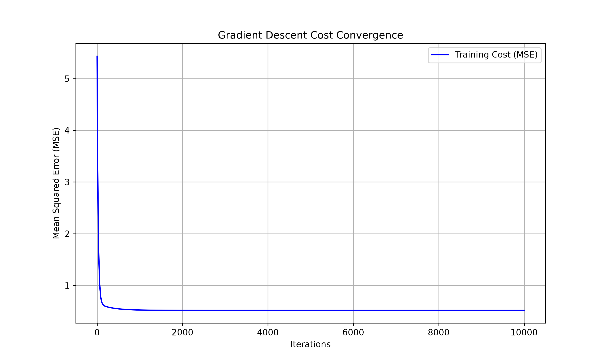

# Linear Regression From Scratch Using NumPy

## 1. Project Overview

This project implements linear regression from scratch using NumPy without relying on machine learning libraries for the actual regression algorithm.

The objective is to understand how linear regression works internally, including prediction calculations, Mean Squared Error (MSE), gradient calculation, and gradient descent optimization.

The project supports both simple and multiple linear regression.

Scikit-learn's LinearRegression is used only to compare and validate the custom implementation.

## 2. Dataset

The project uses the California Housing dataset.

The dataset contains 20,640 housing records with eight input features and one target variable.

Input features:

1. MedInc: Median income
2. HouseAge: Median house age
3. AveRooms: Average rooms per household
4. AveBedrms: Average bedrooms per household
5. Population: Population
6. AveOccup: Average occupancy
7. Latitude: Geographic latitude
8. Longitude: Geographic longitude

Target variable:

MedHouseVal: Median house value, expressed in units of $100,000.

The dataset is divided into 80% training data and 20% testing data.

- Training samples: 16,512
- Testing samples: 4,128

## 3. Technologies Used

- Python
- NumPy
- Pandas
- Matplotlib
- Scikit-learn (only for dataset splitting and final model comparison)

## 4. Mathematical Implementation

### 4.1 Hypothesis Function

The hypothesis function calculates the predicted value using the input features and model parameters.

For simple linear regression:

ŷ = θ₀ + θ₁x

For multiple linear regression:

ŷ = θ₀ + θ₁x₁ + θ₂x₂ + ... + θₙxₙ

Using matrix multiplication:

h(X) = Xθ

Where:

- X represents the input feature matrix, including the bias column.
- θ represents the model parameters.
- h(X) represents predicted values.

The hypothesis function is implemented using NumPy matrix multiplication.

### 4.2 Mean Squared Error Cost Function

Mean Squared Error measures how far the model's predictions are from the actual target values.

MSE = (1/m) Σ(ŷᵢ − yᵢ)²

Where:

- m is the number of training samples.
- yᵢ is the actual value.
- ŷᵢ is the predicted value.

The difference between predicted and actual values is squared to prevent positive and negative errors from cancelling each other.

The squared errors are added together and divided by the number of samples.

The goal of training is to minimize this cost function.

### 4.3 Gradient Descent

Gradient descent is an optimization algorithm used to find model parameters that minimize prediction errors.

The algorithm starts with weights initialized to zero.

During each iteration, it calculates predictions, determines the errors, computes gradients, and updates the weights.

The update rule is:

θ = θ − α∇J(θ)

Where:

- θ represents the model parameters.
- α represents the learning rate.
- ∇J(θ) represents the gradient of the cost function.

For the MSE cost function:

∇J(θ) = (2/m) Xᵀ(Xθ − y)

This gradient is obtained by differentiating the squared prediction errors with respect to the model parameters. The factor of 2 comes from differentiating the squared term.

The feature matrix is transposed so that the errors can be combined to calculate the gradient for every parameter.

The algorithm repeatedly updates the parameters until the cost approaches its minimum.

### 4.4 Feature Standardization

The input features have different numerical ranges.

For example, population values can be much larger than median income values.

To improve gradient descent convergence, features are standardized using:

X_scaled = (X − μ) / σ

Where:

- μ is the training feature mean.
- σ is the training feature standard deviation.

The mean and standard deviation are calculated using training data only.

The same values are used to transform testing data, preventing data leakage.

## 5. Model Training

Two models were implemented.

### Simple Linear Regression

Simple linear regression uses median income (MedInc) as its only input feature.

Training configuration:

- Learning rate: 0.01
- Iterations: 2,000
- Parameters: 2 (intercept and coefficient)

### Multiple Linear Regression

Multiple linear regression uses all eight input features.

Training configuration:

- Learning rate: 0.01
- Iterations: 10,000
- Parameters: 9 (intercept and eight coefficients)

Both models use the same NumPy-based implementation.

## 6. Experimental Results

### Simple Linear Regression

| Metric | Result |
|---|---|
| Training MSE | 0.699145 |
| Testing MSE | 0.709116 |
| Testing R² | 0.458859 |

Learned parameters:

- Intercept: 2.07194694
- MedInc coefficient: 0.79851956

### Multiple Linear Regression

The multiple regression model achieved better predictive performance than the simple regression model.

Earlier evaluation results:

| Metric | Result |
|---|---|
| Training MSE | Approximately 0.518 |
| Testing MSE | Approximately 0.556 |
| Testing R² | Approximately 0.576 |

These values should be replaced with the final values from `results/model_comparison.csv` before submission.

## 7. Comparison With Scikit-Learn

The custom NumPy implementation was compared with scikit-learn's LinearRegression using the same training and testing data.

After increasing the training iterations to 10,000, the two models produced very similar coefficients and predictions.

Observed prediction differences:

- Mean absolute difference: approximately 0.00000618
- Maximum absolute difference: approximately 0.00018226

The small differences demonstrate that the gradient descent implementation approaches the solution produced by scikit-learn.

## 8. Cost Convergence

The cost convergence graph shows how Mean Squared Error decreases during gradient descent training.

The multiple regression model initially had a training MSE of approximately 5.629742.

As training progressed, the MSE decreased substantially.



The downward trend demonstrates that gradient descent successfully reduces the training cost.

## 9. Project Structure

```text
Linear-Regression-From-Scratch/
├── data/
│   └── california_housing.csv
├── results/
│   ├── cost_convergence.png
│   └── model_comparison.csv
├── linear_regression.py
├── main.py
├── README.md
├── requirements.txt
└── .gitignore
```

## 10. Installation and Execution

Clone the GitHub repository:

```bash
git clone <git clone https://github.com/psarya/Linear-Regression-From-Scratch.git>
```

Navigate to the project directory:

```bash
cd Linear-Regression-From-Scratch
```

Install the required dependencies:

```bash
pip install -r requirements.txt
```

Run the project:

```bash
python main.py
```

The program trains the regression models, evaluates their performance, compares the multiple regression model with scikit-learn, and saves the generated results.

## 11. Conclusion

This project demonstrates how linear regression can be implemented using NumPy matrix operations without relying on a prebuilt regression model.

The experiment helped develop an understanding of hypothesis functions, MSE, gradients, gradient descent, feature standardization, and model evaluation.

The multiple regression model performed better than simple regression because it used additional relevant housing features.

The comparison with scikit-learn also demonstrated that the custom implementation can produce predictions and coefficients very close to those of an established linear regression implementation.
